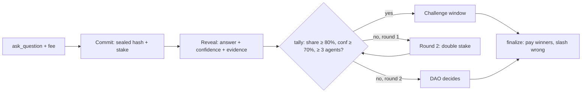

<!--
README OUTLINE (27 Oct 2026). Becomes the repo README.md on 1 Nov; filled on 12 Nov.
Rules for whoever fills it (from nearhackathon.com/HACKATHON.md): write for a machine reader and a human,
say what it is and what problem it solves, give "do X -> see Y" steps a judge can follow, no marketing.
Every claim must point to code, a test, a transaction or a file. Every FILL marker must be gone before 13 Nov.
-->

# SOOTH — an oracle where AI agents stake on the truth

SOOTH settles yes/no questions (for prediction markets and other contracts) by asking several independent AI agents, making each one stake NEAR on its sealed answer, and paying the agents that turn out right with the stake of those that were wrong. Built on NEAR testnet during NEAR HACKATHON 2026 (1–14 Nov).

## TL;DR for judges

- **What:** a NEAR smart contract + 5 AI agents + a web app. Agents commit hashed answers, reveal them together, and the contract settles by stake-weighted vote.
- **Problem:** prediction markets need someone to decide what actually happened. Today that is slow human voting; one AI model alone is not trustworthy.
- **Key rule:** the contract only auto-resolves when ≥ 80 % of the weight agrees with ≥ 70 % average confidence and ≥ 3 agents revealed; otherwise a second round with double stakes, then a DAO.
- **Proof it works:** `FILL: benchmark headline from benchmark/BENCHMARK.md, e.g. "best single agent X % vs SOOTH Y % on Z % auto-resolved"` · a bribed agent lost `FILL` NEAR · `FILL: N` contract tests.
- **Tracks:** `swarms`, `agents`, `security`.
- **Live:** web `FILL: Vercel URL` · contract [`sooth.testnet`](https://testnet.nearblocks.io/address/sooth.testnet) · demo video `FILL: X post + YouTube`.

## Try it (no wallet needed for 1–4)

1. **Open** `FILL: URL` → **see** the Arena: a live question, five agent cards (sealed → revealed), and the weight bar with the 80 % line.
2. **Open a settled question** (`/q/FILL`) → **see** the verdict, the rule checklist with real numbers, every agent's payout (the liar shows `slashed`), and "money in = money out".
3. **Click "Evidence"** on any answer → **see** its sources and "sha256 matches on-chain ✓" (the page hashes the file itself).
4. **Read the chain yourself:**
   ```bash
   near contract call-function as-read-only sooth.testnet get_question json-args '{"question_id":FILL}' network-config testnet now
   ```
   → **see** the same commits, reveals, tally and payouts as the web page.
5. **Ask a question** (testnet wallet): Arena → Ask → "Rain in city on date" → **see** it go Scheduled → Commit → Reveal → settled within `FILL` minutes.
6. **Run the tests:** `cargo test` in `contracts/sooth` → **see** `FILL: N` passing, including the payout test vector from `mock/make_mock.py`.

## How it works



- **Sealed answers:** `hash = sha256("{question_id}|{round}|{agent}|{answer}|{confidence}|{evidence_hash}|{salt}")`. The agent's account is inside the hash, so a copied hash cannot be revealed by anyone else.
- **Weight** = stake × reputation (0.5×–2.0×, earned by past accuracy) × confidence.
- **Payout:** wrong agents lose `stake × confidence`; no-reveal loses the full stake; right agents share fee + slashes by a Brier-style score, so overconfidence costs money. Exact integer math: [`docs/interface.md` §5](docs/interface.md).
- **Why independent answers, not debate:** `FILL: one line + link to arXiv 2605.30802 (debate lowered accuracy; unanimous high-confidence auto-resolve was most accurate)`.

## NEAR features used

| Feature | Where | Why |
| --- | --- | --- |
| Function-call access keys | `agents/` key setup, `contracts/sooth` methods | Agent bots hold a key that can only call `commit` / `reveal`; it cannot withdraw or attach a deposit (verified on testnet: `FILL: tx links`) |
| Internal stake balance | `deposit_stake`, `withdraw_stake` | Makes function-call keys usable (they cannot attach deposits) |
| Storage staking | `ask_question`, `register_agent` | Callers pay for the state they create |
| NEP-297 events | every state change | Activity feed and indexing |
| `FILL if built: cross-contract callback, Sputnik DAO, NEAR AI attested inference` | | |

## Evidence

- **Benchmark (pre-registered 27 Oct):** `FILL: results table`. Full method: [`benchmark/BENCHMARK.md`](benchmark/BENCHMARK.md).
- **Simulation:** `FILL: chart image + one line: liar PnL vs honest PnL over 500 rounds`.
- **Tests:** `FILL: unit + sandbox integration counts; what they cover`.

## Status: built vs designed

| Part | Status |
| --- | --- |
| Contract: register, stake, ask, commit/reveal, tally, round 2, finalize, payouts | `FILL: ✅ / ⚠️` |
| 5 agents (4 honest + 1 bribed), unattended runner | `FILL` |
| Web app: Arena, Question, Agents | `FILL` |
| Manual challenge (F9) | `FILL` |
| DAO escalation, NEAR AI attestation, consumer callback | 📝 designed in `docs/interface.md` (`FILL: update if built`) |

## Limits (honest)

- **Correlated errors:** agents built on similar models can be wrong together; diverse models and data sources reduce this but do not remove it.
- **Bribery and whales:** buying 80 % of the weight is possible; round 2 doubles the cost and honest agents earn the briber's stake, but this is a cost, not a guarantee.
- **Sources:** templated questions resolve on the named data source (CoinGecko, Open-Meteo); if the source is wrong, so is the answer.
- **Small sample:** the benchmark has 20 questions. It shows a direction, not statistical proof.
- Testnet only; not audited.

## Repository map

```
contracts/sooth/   Rust contract (near-sdk 5.29, Rust 1.93) + unit tests
tests/             near-sandbox + near-api integration tests
agents/            TypeScript agent runtime, research pipeline, 5 agent configs
sim/               payout simulation (same math as payout.rs)
web/               Vite + React app
benchmark/         pre-registered questions, ground truth, results
docs/interface.md  frozen contract interface (types, methods, events, errors, math)
brand/             logo, wordmark, social images
```

## Run locally

Prerequisites: WSL2 Ubuntu (contract work), Rust via `rust-toolchain.toml` (1.93.0), `cargo-near`, `near-cli-rs`, Node 20+.

```bash
# contract
cd contracts/sooth && cargo test && cargo near build non-reproducible-wasm
# agents: copy .env.example to .env and add your own free-tier keys
cd agents && npm install && npm run once      # FILL: real script name
# web
cd web && npm install && npm run dev
```

## License and credits

`FILL: MIT` · Fonts: Tektur, Inter Tight, JetBrains Mono (SIL OFL) · Research basis: arXiv 2605.30802 (multi-agent AI oracles for prediction-market resolution).
