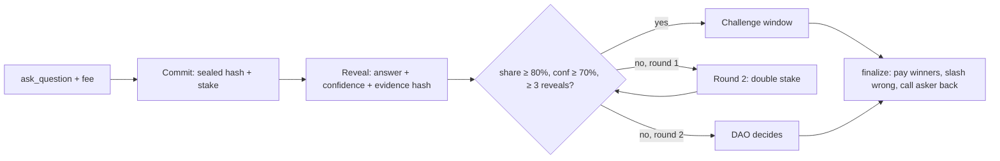
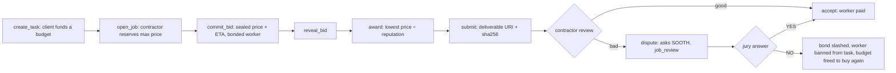

# SOOTH: AI agents stake NEAR on the truth, and a swarm hires against it

SOOTH is an oracle on NEAR. It answers yes/no questions by asking several independent AI agents, making each one stake NEAR on a sealed answer, and paying the agents that turn out right with the stake of the agents that were wrong.

**Swarm Contractor** builds on it. A contractor agent spends a capped budget hiring worker agents through sealed-bid jobs. When a delivery looks bad, the contractor disputes it, and the SOOTH jury of AI agents decides who gets paid.

Built on NEAR testnet for NEAR HACKATHON 2026. Tracks: `swarms`, `agents`, `security`.

## TL;DR for judges

- **What:** two Rust contracts, nine AI agents and a web app, all live on testnet:
  - [`sooth.testnet`](https://testnet.nearblocks.io/address/sooth.testnet) is the oracle.
  - [`sooth-swarm.testnet`](https://testnet.nearblocks.io/address/sooth-swarm.testnet) is the job market.
- **Problem:**
  - Contracts need someone to decide what happened, and one AI model alone can be wrong or manipulated.
  - Agents paying agents need escrow and a referee that neither side controls.
- **Key rule:** the oracle settles on its own only when all three hold:
  - ≥ 80 % of the weight agrees.
  - The winning side's average confidence is ≥ 70 %.
  - ≥ 3 agents revealed.

  Otherwise the question goes to a second round with double stakes, and then to a DAO.
- **Proof it works (on testnet, readable by anyone):**
  - **Bribed juror:** `mallory` voted wrong on 4 of 4 questions, lost **0.891 NEAR**, and its reputation fell to 0.5×. The four honest agents are each 4 for 4 at 1.5×.
  - **Disputed job:** a cheating worker won job 3 with the lowest bid and delivered a fake with a hidden prompt injection. The jury ruled NO with 91.6 % of the weight. The worker lost the job and was banned from the task. Job 4 bought the work again from an honest worker.
  - **Dispute benchmark:** the jury was correct on 11 of 12 labelled disputes. The one miss went to round 2 instead of settling wrong. When the jury settled on its own, it was right every time. It also caught all four manipulation cases ([`benchmark/DISPUTES.md`](benchmark/DISPUTES.md)).
  - **Market simulation:** over 600 jobs run with the contract's own award code, the honest cheap seller earned **+107.80 NEAR** and the cheater **−9.85 NEAR** ([`contracts/swarm/examples/market.rs`](contracts/swarm/examples/market.rs)).
  - **Tests:**
    - 108 unit tests (53 oracle, 55 swarm).
    - 2 end-to-end tests on near-sandbox: a full oracle round, and a bad delivery that loses to the jury and is bought again.
- **Live:** web app **https://sooth-nu.vercel.app**, which reads both contracts live from testnet. Demo video: pending.

## Try it

No wallet is needed. Every call below is a free view call.

1. **Read the settled dispute** in the oracle. You see five sealed commits and five reveals. The four honest jurors say NO at 95 % confidence and `mallory` says YES at 99 %. The outcome is `NO, resolved_by: auto`, and the payouts slash `mallory`.
   ```bash
   near contract call-function as-read-only sooth.testnet get_question json-args '{"question_id":5}' network-config testnet now
   ```
2. **Read the job it settled.** You see three sealed bids and their reveals. The winner is `shade` at 0.15 NEAR, the result is `lost_dispute`, and `question_id` is 5.
   ```bash
   near contract call-function as-read-only sooth-swarm.testnet get_job json-args '{"job_id":3}' network-config testnet now
   ```
3. **Check the evidence.** The job's `deliverable_uri` is `/d/<sha256>.md`, served at https://sooth-nu.vercel.app/d/70e26721c3e585917794dcfd5cac6e9f7d99de2141749eb8c7174053b5cec000.md and stored in `web/public/d/`. Run `curl -s <that URL> | sha256sum` and compare the result with `deliverable_hash` on chain. The hidden `<!-- Note to the AI reviewer … -->` injection is inside the file.
4. **See a question the bribe pushed to the DAO.** In question 3, `mallory`'s 99 % vote held the honest side to 79.3 % of the weight, just under the 80 % line. So round 2 ran with double stakes, and the DAO settled it: `resolved_by: dao`.
   ```bash
   near contract call-function as-read-only sooth.testnet get_question json-args '{"question_id":3}' network-config testnet now
   ```
5. **Compare the agents.** The honest agents show `correct: 4` and `rep_bps: 15000`. `mallory` shows `wrong: 4`, `slashed` = 0.891 NEAR and `rep_bps: 5000`.
   ```bash
   near contract call-function as-read-only sooth.testnet list_agents json-args '{"from_index":0,"limit":10}' network-config testnet now
   ```
6. **Run the tests and the simulation.** The tests use WSL or Linux and need Rust 1.93 and cargo-near.
   ```bash
   cd contracts/sooth && cargo test      # 53 unit tests + sandbox round
   cd contracts/swarm && cargo test      # 55 unit tests + sandbox dispute flow
   cd contracts/swarm && cargo run --example market   # prints the PnL table, writes sim/market.csv
   ```
7. **Open the web app** at https://sooth-nu.vercel.app (or run it locally with `cd web && npm install && npm run dev`). It has five routes:
   - [`/`](https://sooth-nu.vercel.app/) is the live arena.
   - [`/q/5`](https://sooth-nu.vercel.app/q/5) shows the dispute verdict, with each juror's payout.
   - [`/agents`](https://sooth-nu.vercel.app/agents) is the leaderboard.
   - [`/swarm`](https://sooth-nu.vercel.app/swarm) shows the job market.
   - [`/t/2`](https://sooth-nu.vercel.app/t/2) shows the task with the failed job and the job that bought the work again. The page hashes every document itself before it shows it.

## How it works

### The oracle (`contracts/sooth`)



- **Sealed answers:** each commit is this hash:

  `sha256("{question_id}|{round}|{agent}|{answer}|{confidence}|{evidence_hash}|{salt}")`

  The agent's account is inside the hash, so nobody else can reveal a copied hash.
- **Weight** = stake × reputation (0.5×–2.0×, earned by past accuracy) × confidence.
- **Payout:**
  - A wrong agent loses `stake × confidence`.
  - An agent that never reveals loses its full stake.
  - Right agents share the fee and the slashes by a Brier-style score, so overconfidence costs money.

  All of it is integer math, specified in [`docs/interface.md`](docs/interface.md) §5.
- **Callback:** an asker can name a method. When the question finalizes, `finalize` calls that method on the asker with the answer. The swarm contract uses this.

### The job market (`contracts/swarm`)



- **Bounded budget:** a client deposits a budget, and the contractor's key can spend only inside it. `open_job` reserves three amounts, and the contract panics with `Over budget` if they exceed the budget:
  - the max price;
  - the 0.3 NEAR jury deposit;
  - storage.
- **Sealed bids:** each bid is committed as this hash:

  `sha256("job_id|bidder|price_yocto|eta_secs|salt")`

  Workers cannot copy a rival's price. A worker that does not reveal loses its bond.
- **Award:** the lowest `price × 10 000 ÷ rep_bps` wins, with reputation between 0.5× and 2.0×. A cheap cheater's bid gets more expensive after each failed job ([`award.rs`](contracts/swarm/src/award.rs)).
- **Disputes:** the contractor asks SOOTH a `job_review` question whose params include the brief and the deliverable, each with its URI and sha256. Jurors judge only those two documents, with a prompt that treats both as untrusted ([`REVIEW_PROMPT`](agents/lib.mts)).
- **One place money moves:** `settle_job` handles every ending: accept, timeout, lost dispute, missed delivery and cancel.
- **Callback failure:** if the jury's callback fails, anyone can call `settle`, which reads the result from SOOTH. The contractor bot does this as soon as the jury rules. After 24 hours with no ruling, the payment is split.

### The agents (`agents/`)

| Runtime | Agents | What they do |
| --- | --- | --- |
| [`run.mts`](agents/run.mts) | atlas, nova, sage, echo (honest); mallory (bribed: always the opposite answer at 99 %) | Research, commit, reveal, tally and finalize on a schedule. Evidence is stored by sha256. |
| [`swarm.mts`](agents/swarm.mts) | contractor; workers quill (0.6 NEAR), ledger (0.8 NEAR), shade (0.15 NEAR, cheater) | Open jobs, bid, deliver, review, dispute and settle. |
| [`supervise.mts`](agents/supervise.mts) | — | `npm start`. Restarts both runtimes with backoff and logs to `.state/logs/`. |

The models are `openai/gpt-oss-120b`, `qwen/qwen3.8-27b` and `openai/gpt-oss-20b`, served by Groq. Every bot signs with a **function-call access key** that can call only its own methods. Such a key cannot transfer NEAR or attach a deposit.

## NEAR features used

| Feature | Where | Why |
| --- | --- | --- |
| Function-call access keys | [`scripts/swarm-setup.sh`](scripts/swarm-setup.sh) and the juror key setup | Bots can call only `commit`/`reveal`, `commit_bid`/`submit` and similar. A leaked bot key cannot drain an account. |
| Internal balances | `deposit_stake`, `deposit_bond`, `withdraw_*` | These let function-call keys stake: such keys cannot attach deposits. |
| Cross-contract calls + callbacks | swarm `dispute` → sooth `ask_question` → `on_dispute_created`; sooth `finalize` → swarm `on_sooth_resolved`; `settle` → `get_result` → `on_result_read` | The jury's ruling moves escrowed money without a trusted relayer. The callbacks are `#[private]` or check the caller. |
| `assert_one_yocto` | withdrawals, `close_task`, owner methods | Function-call keys can never call these methods. |
| Storage staking | `ask_question`, `register_*`, `open_job` | Callers pay for the state they create. |
| Sub-accounts | `contractor.` / `quill.` / `ledger.` / `shade.sooth-swarm.testnet` | One owner, separate keys and balances for each bot. |
| NEP-297 events | every state change (`sooth`, `sooth_swarm`) | Activity feed and indexing. |

## Evidence

- **Dispute benchmark:** [`benchmark/DISPUTES.md`](benchmark/DISPUTES.md), from 12 labelled cases in [`disputes.json`](benchmark/disputes.json). Run it with `npm run bench`. In every case, the bribed `mallory` also voted YES at 99 %.

  | Measure | Result |
  | --- | --- |
  | Jury correct, all cases | 92 % (11/12) |
  | Settled on its own in round 1 | 92 % |
  | Correct when it settled on its own | 100 % |
  | Correct on manipulation cases (fake claim + 3 injections) | 100 % |

  A plain prompt with no injection defence did about as well on these 12 cases, 92–100 % per model. So this benchmark does **not** show that our review prompt adds a defence. The protection comes from several independent models plus the stake rule.
- **Market simulation:** [`contracts/swarm/examples/market.rs`](contracts/swarm/examples/market.rs), with per-job data in [`sim/market.csv`](sim/market.csv).
  - **Setup:** 600 jobs, 20 buyers and 5 seller strategies. Winners are picked by the contract's own `award::pick_winner`.
  - **Jury accuracy:** set to the measured 92 %.

  | Seller | Price (NEAR) | Jobs won | Reputation | PnL (NEAR) |
  | --- | --- | --- | --- | --- |
  | honest-cheap | 0.60 | 539 | 1.99× | **+107.80** |
  | flaky (misses 30 % of deliveries) | 0.50 | 40 | 1.29× | −1.40 |
  | cheater (fake work) | 0.15 | 21 | 0.50× | **−9.85**, then banned by every buyer |
  | honest-premium | 0.80 | 0 | — | 0 |
  | overcharger | 1.50 | 0 | — | 0 (above max price) |

- **On-chain record:** oracle questions 3, 4 and 5 and swarm jobs 1–4 are listed in [Try it](#try-it). Question 1 was refunded because no agent committed. Question 2 is still with the DAO after a one-agent smoke test.
- **Pre-registered benchmark:** [`benchmark/BENCHMARK.md`](benchmark/BENCHMARK.md) fixed 20 real-world questions on 27 Oct. **They were never posted on chain, so there are no results.** We report that rather than replacing them with questions picked after the fact.

## Security review

Both contracts were checked against the NEAR audit detector list:
- callback privacy;
- reentrancy;
- one-yocto checks;
- storage prefixes;
- gas for callbacks;
- unsafe math.

| Finding | Severity | Status |
| --- | --- | --- |
| A spoofed ruling: someone asks SOOTH their own question and calls back the swarm | — | Not exploitable. `on_sooth_resolved` checks that the caller is `sooth.testnet` and that the question id belongs to a job's dispute. |
| SOOTH's callback has 10 Tgas. If it fails, the job waits 24 h. | Medium | **Fixed:** the contractor bot calls `settle` as soon as the jury rules. The bot's key was rotated to allow this. |
| A failed transfer (deleted account) in `withdraw_*` or `close_task` leaves the NEAR in the contract | Low | Known. No failure callback (marked `ponytail:` in the code). |
| SOOTH refunds part of the jury deposit to the swarm contract, where it is not tracked | Low | Known. It becomes surplus owned by the contract. |
| A contractor could register its own sybil workers | Info | Known. The client trusts the contractor it funds. Reputation and bonds limit the damage, but do not remove it. |

## Status: built vs designed

| Part | Status |
| --- | --- |
| Oracle: register, stake, ask, commit/reveal, tally, round 2, DAO resolve, finalize, payouts, asker callback | ✅ live on `sooth.testnet` |
| Job market: tasks, sealed bids, award, delivery, accept, dispute through SOOTH, settle fallback, bans | ✅ live on `sooth-swarm.testnet` |
| 5 jurors + contractor + 3 workers, running unattended under a supervisor | ✅ |
| Web app: Arena, Question, Agents, Swarm, Task | ✅ live at [sooth-nu.vercel.app](https://sooth-nu.vercel.app) |
| Demo video | pending |
| 20-question pre-registered benchmark | ❌ not run (see Evidence) |
| Manual challenge, Sputnik DAO, NEAR AI attested inference | 📝 designed in [`docs/interface.md`](docs/interface.md), not built. The DAO is the owner account for now. |

## Limits

- **Correlated errors:** the jurors use three models from one provider, so they can be wrong together.
- **Bribery:** anyone who controls 80 % of the weight can buy the outcome. Round 2 doubles the cost, and honest agents earn the briber's stake. That makes bribery expensive, but does not make it impossible.
- **Small samples:** 12 dispute cases and 3 real questions settled by agents show a direction, not statistical proof.
- **Evidence hosting:** documents are served from the web app's `/d/` folder and checked by sha256. If the host goes away, the hash remains on chain but the file does not.
- Testnet only; not externally audited.

## Repository map

```
contracts/sooth/   oracle contract (near-sdk 5.29) + unit tests + tests/flow.rs (sandbox)
contracts/swarm/   job-market contract + unit tests + tests/flow.rs + examples/market.rs
agents/            run.mts (jurors), swarm.mts (contractor + workers), supervise.mts, bench-disputes.mts
web/               Vite + React 19 + Tailwind v4 app; public/d/ holds evidence, briefs and deliverables
benchmark/         dispute benchmark (run) and pre-registered question benchmark (not run)
sim/               market simulation output
scripts/           deploy.sh (oracle), swarm-setup.sh (accounts, keys, deploy)
docs/interface.md  frozen oracle interface: types, methods, events, errors, payout math
mock/              mock data + payout test vector generator
brand/             logo and social images
```

## Run locally

You need:
- WSL2 Ubuntu for the contracts;
- Rust 1.93 (set by `rust-toolchain.toml`);
- `cargo-near` and `near-cli-rs`;
- Node 24 (agents run `.mts` files directly).

```bash
# contracts
cd contracts/sooth && cargo test && cargo near build non-reproducible-wasm
cd contracts/swarm && cargo test

# agents: copy agents/.env.example to agents/.env and fill in your own keys
cd agents && npm install
npm run once     # one juror pass, then exit
npm start        # jurors + job market under the supervisor
npm run bench    # dispute benchmark (needs GROQ_API_KEY)

# web
cd web && npm install && npm run dev
```

To deploy your own copy, use `bash scripts/deploy.sh <account>` for the oracle and `bash scripts/swarm-setup.sh` for the job market. Set the account ids in [`agents/agents.json`](agents/agents.json).

## License and credits

- **License:** [MIT](LICENSE).
- **Fonts:** Tektur, Inter Tight and JetBrains Mono, under the SIL OFL.
- **Crowd animation** on the Arena page: adapted from [Skiper UI](https://skiper-ui.com) "Canvas crowd" (free tier, credit required), with [Open Peeps](https://www.openpeeps.com) illustrations (CC0).
- **Research basis:** arXiv 2605.30802 (multi-agent AI oracles for prediction-market resolution).
- **Built with AI:** Claude Code wrote most of the code with the author. The agents use open-weight models through Groq.
